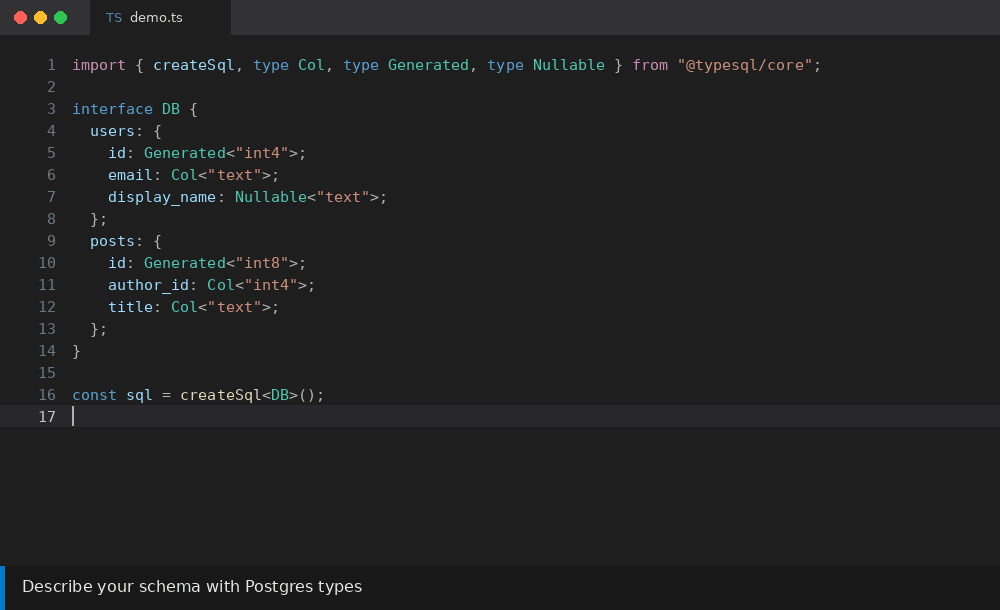
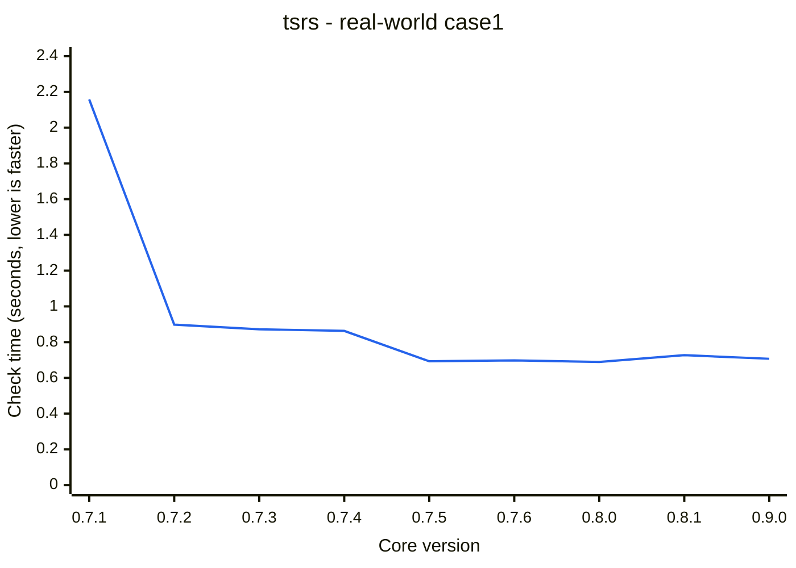

# TypeSQL

Write SQL in TypeScript and get exact types for rows and parameters. TypeSQL parses your SQL inside the type checker: no codegen, no database connection, no build step.

TypeSQL supports PostgreSQL and SQLite. MySQL is planned.



## Why TypeSQL

- **Plain SQL.** You write the SQL your database runs, not a query builder's version of it.
- **No codegen.** Types update as you type. There is no generate step to rerun and no database to keep running for it.
- **Mistakes are compile errors.** A misspelled column, an unknown table or a wrong parameter type is caught in your editor, worded like the error your database would give.
- **Real database rules.** A `LEFT JOIN` makes columns nullable, `WHERE x IS NOT NULL` makes them non-null, and `count(*)` is never null.
- **Editor support.** SQL inside `sql()` strings gets completions and syntax highlighting, like code in a `.sql` file.

## Install

```sh
npm install @typesql/core @typesql/pg pg
npm install @typesql/core @typesql/postgres postgres
npm install @typesql/core @typesql/sqlite
```

Requires TypeScript 7.1 or later.

## Quick start

Describe your tables with your database's type names, then write queries:

```ts
import { createSql } from "@typesql/core";
import { type Col, type Generated, type Nullable, postgres } from "@typesql/core/postgres";

interface DB {
  users: {
    id: Generated<"int4">;
    email: Col<"text">;
    display_name: Nullable<"text">;
  };
  posts: {
    id: Generated<"int8">;
    author_id: Col<"int4">;
    title: Col<"text">;
  };
}

const sql = createSql<DB>(postgres);

const query = sql(
  `SELECT u.email, p.title
   FROM users u LEFT JOIN posts p ON p.author_id = u.id
   WHERE u.id = $1`,
  7,
);

sql("SELECT emial FROM users");
```

The `LEFT JOIN` makes `title` nullable, and `$1` takes the type of `u.id`.

## Use with Kysely, Drizzle or Prisma

Already have a schema in one of them? `@typesql/kysely`, `@typesql/drizzle` and `@typesql/prisma` turn it into the one TypeSQL needs. See [From Kysely, Drizzle or Prisma](https://typesql.karsli.net/guide/orms).

## Editor support

Every TypeScript editor shows a query's row type on hover and underlines mistakes in the SQL. Install the TypeSQL extension for VS Code ([Marketplace](https://marketplace.visualstudio.com/items?itemName=typesql.typesql), [Open VSX](https://open-vsx.org/extension/typesql/typesql)) to also get:

- **Completions** for tables, views and schemas after `FROM`, `JOIN`, `INTO` and `UPDATE`, and for columns with their SQL types after `alias.` and in expressions.
- **Syntax highlighting** for keywords, types, functions, strings, `$1` parameters and more inside `sql()` strings.

```ts
sql("SELECT * FROM |");
sql("SELECT u.| FROM users u");
```

Suggestions come from your `DB` type and follow it as you edit, unsaved changes included. See [VS Code extension](https://typesql.karsli.net/guide/vscode) for the setup. [Neovim](https://typesql.karsli.net/guide/neovim) gets the same completions through `@typesql/language-server`.

## Try it online

[Open the example in the TypeScript Playground](https://www.typescriptlang.org/play/#code/JYWwDg9gTgLgBAbzgYygUwIYzQZQI4A2ANHDAJ5hpwAKGUGIAzgCoVonmVwBKEA7qy4BfOADMoEEHABEAAU5pGhAPTJoaaQG4AUKEixE2gJAK4AYQjFjpgOJoAdmnrYAJkWts4AOQCuBAhgARgTsxpCMMADm6IzuIuKSMvJsSgSq6srhUTFa2rr22FCiGMhUACIAQoZGPoxOjABc1UbALk12js5oLgA80sAFACzSAHw6RkZoIBjABE0WBH3YAB4wo+NGLsCMYAFkAPr2DGhNvv5BIUtoq+vGRqiYrvtY7Q5OWN1LoIowDGAwAC9bkYhOMso1mq1Xp0Pr1+gUABzAowYHwwAAW0H2UPMlj6AxgwzGdxgwBgIXmeOkKzWxImgQgLjIpz8AWCaCuNzpoO0QjyansETgqTgAF4UOgPvhFpURgAKLLRRQASh02gFQrwYuFhDlxgABjgAKIAGSNZmYcB8ADpWiQbVMZsQ4GBraTyWhtHBvT7fX6AGLcADyAFkrXUoIwrXAzf7LQApIMASS8LogESjYDgQdTrtRGKxrW1NtaXr95Z9AHUABJG7hGq22lzagAkAEZ9e4jAB2dyq7SmXh8bVDwQchQQURwPDE0y0ehMbXzhgsNg9CdTmdqjXwCJYKPi1J6oyG03my35zFQbFuFAQHwFOUAKmVJGmyzl7pCyrgAEEcHAATYEKgahmmGZwDYwYAKrUHAFQAJpwJehYuJ22j9qYOC-DAB48PwY7rmwk7CjhjDEuqECCvAjqzNq0gYC4GCyNcfwhNaaggLkO4So83TakeBopsa3CWimzBBuG9RwHKtEED+ABqv4mtBRoAXKLYIKk1pgHQDCydMszKkIP71sw0HcF4KY2HAdq8bCzwwOhmGeGYkquCOBFrhu9muBRR6nmaFpwPYIBUKBYa1PU+r9gFwl1mJXgSeBuEyV+aCKcpqnqe2yqdjI1ZoP4EDSP2QA) <span data-playground="core"></span>: edit the SQL and hover the types, with nothing to install. The Playground runs TypeScript 6, so treat it as a demo.

## Run queries

Create `sql` from your driver's client and run queries with it:

```ts
import { Pool } from "pg";
import { createSql } from "@typesql/pg";

const sql = createSql<DB>(new Pool());

const posts = await sql("SELECT id, title FROM posts WHERE author_id = $1", 1).execute();

const user = await sql("SELECT email FROM users WHERE id = $1", 7).executeTakeFirstOrThrow();

await sql.transaction(async (tx) => {
  await tx("UPDATE posts SET title = upper(title) WHERE author_id = $1", 1).execute();
});
```

`@typesql/postgres` works the same way with postgres.js, and `@typesql/sqlite` with node:sqlite, better-sqlite3 and bun:sqlite. For SQLite, describe tables with SQLite's type names and the `sqlite` dialect from `@typesql/core/sqlite`; see [SQLite](https://typesql.karsli.net/guide/sqlite).

## Get your schema

Generate it from a live database with [`@typesql/cli`](https://www.npmjs.com/package/@typesql/cli):

```sh
npx typesql introspect --url postgres://localhost/app --out src/db/schema.ts
npx typesql introspect --dialect sqlite --db app.db --out src/db/schema.ts
```

Or derive it from your migrations:

```ts
import type { SchemaOf } from "@typesql/core";
import { migrations } from "@typesql/core/postgres";

const m = migrations()
  .add("CREATE TABLE users (id serial PRIMARY KEY, email text NOT NULL)")
  .add("ALTER TABLE users ADD COLUMN display_name text");

type DB = SchemaOf<typeof m>;
```

## Tested against the database's own tests

The parser is checked against the regression tests the database runs on itself. For PostgreSQL that is about 50,000 statements, and TypeSQL agrees with Postgres on every one that can be checked statically: it parses what Postgres parses and rejects what Postgres rejects. CI fails on a single disagreement. See [Postgres compatibility](https://typesql.karsli.net/guide/postgres-compatibility). SQLite statements are compared with the SQLite that ships with Node: outcome, error message, column names and the values each column returns.

## Compile time

<span id="performance-summary-start"></span>
The [real-world application workload](packages/bench/src/case1.ts) contains 379 statements and reusable SQL fragments. Average check time per statement, including schema and fragment checking: 6.72 ms with `tsc` and 1.87 ms with [tsrs](https://github.com/oxc-project/tsrs).

| Application workload | `tsc` | tsrs |
|---|---|---|
| `case1` | 2.546 s | 0.707 s |
<span id="performance-summary-end"></span>

See [Performance](https://typesql.karsli.net/guide/performance) for how this is measured.

### Performance by release

tsrs check time for the [real-world application](packages/bench/src/case1.ts) by `@typesql/core` version. Lower is faster. Every refresh remeasures all releases from 0.7.1 in one CI job with the same compilers, using the median of three checks per variant.

<span id="performance-history-start"></span>


<span id="performance-history-end"></span>

[Measurement history](packages/bench/history.json).

## Documentation

The full guide is at **[typesql.karsli.net](https://typesql.karsli.net)**. It covers the SQL TypeSQL supports, parameters and fragments, writing data, performance, and known limits.

## License

[MIT](LICENSE)
