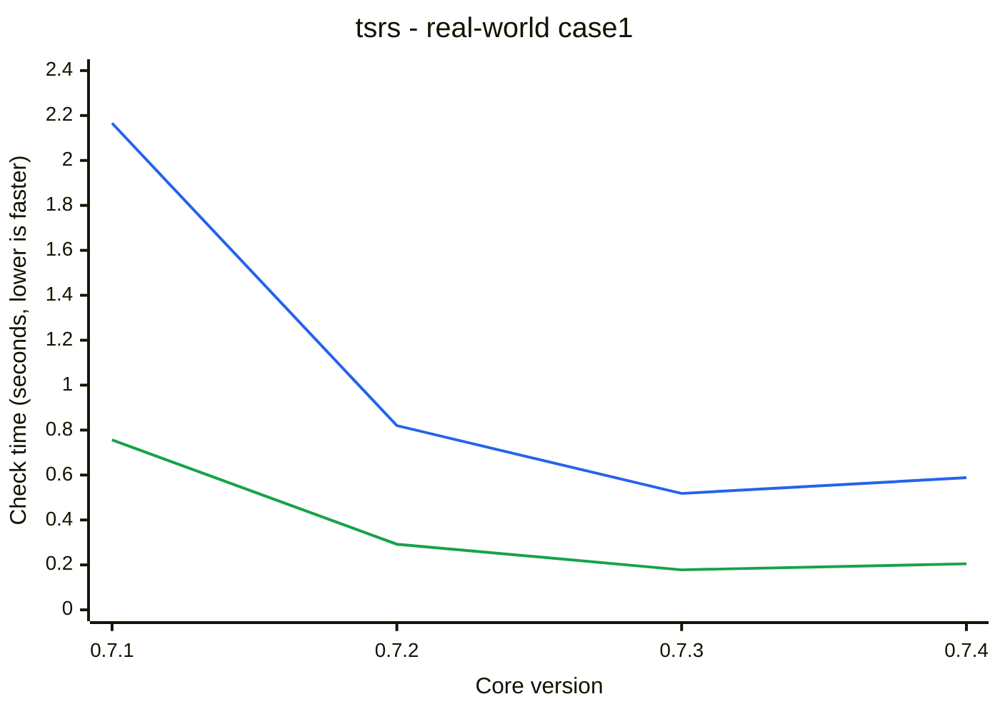

# TypeSQL

Write Postgres SQL in TypeScript and get exact types for rows and parameters. TypeSQL parses your SQL inside the type checker: no codegen, no database connection, no build step.


## Why TypeSQL

- **Plain SQL.** You write the SQL Postgres runs, not a query builder's version of it.
- **No codegen.** Types update as you type. There is no generate step to rerun and no database to keep running for it.
- **Mistakes are compile errors.** A misspelled column, an unknown table or a wrong parameter type is caught in your editor, worded like the error Postgres would give.
- **Real Postgres rules.** A `LEFT JOIN` makes columns nullable, `WHERE x IS NOT NULL` makes them non-null, and `count(*)` is never null.
- **Editor support.** SQL inside `sql()` strings gets completions and syntax highlighting, like code in a `.sql` file.

## Install

```sh
npm install @typesql/core @typesql/pg pg              # node-postgres
npm install @typesql/core @typesql/postgres postgres  # or postgres.js
```

Requires TypeScript 7.1 or later.

## Quick start

Describe your tables with Postgres type names, then write queries:

```ts
import { createSql, type Col, type Generated, type Nullable } from "@typesql/core";

interface DB {
  users: {
    id: Generated<"int4">; // has a default, so optional on INSERT
    email: Col<"text">; // NOT NULL
    display_name: Nullable<"text">; // NULL allowed
  };
  posts: {
    id: Generated<"int8">;
    author_id: Col<"int4">;
    title: Col<"text">;
  };
}

const sql = createSql<DB>();

const query = sql(
  `SELECT u.email, p.title
   FROM users u LEFT JOIN posts p ON p.author_id = u.id
   WHERE u.id = $1`,
  7,
);
// row:    { email: string; title: string | null }
// params: [number | null]

sql("SELECT emial FROM users");
// error: column "emial" does not exist. Perhaps you meant the column "email"?
```

The `LEFT JOIN` makes `title` nullable, and `$1` takes the type of `u.id`.

## Use with Kysely, Drizzle or Prisma

Already have a schema in one of them? `@typesql/kysely`, `@typesql/drizzle` and `@typesql/prisma` turn it into the one TypeSQL needs. See [From Kysely, Drizzle or Prisma](https://typesql.karsli.net/guide/orms).

## Editor support

Every TypeScript editor shows a query's row type on hover and underlines mistakes in the SQL. Install the TypeSQL extension for VS Code ([Marketplace](https://marketplace.visualstudio.com/items?itemName=typesql.typesql), [Open VSX](https://open-vsx.org/extension/typesql/typesql)) to also get:

- **Completions** for tables, views and schemas after `FROM`, `JOIN`, `INTO` and `UPDATE`, and for columns with their Postgres types after `alias.` and in expressions.
- **Syntax highlighting** for keywords, types, functions, strings, `$1` parameters and more inside `sql()` strings.

```ts
sql("SELECT * FROM |");          // users, posts
sql("SELECT u.| FROM users u");  // id: int4, email: text, display_name: text | null
```

Suggestions come from your `DB` type and follow it as you edit, unsaved changes included. See [VS Code extension](https://typesql.karsli.net/guide/vscode) for the setup. [Neovim](https://typesql.karsli.net/guide/neovim) gets the same completions through `@typesql/language-server`.

## Try it online

[Open the example in the TypeScript Playground](https://www.typescriptlang.org/play/#code/PTAEBUE8AcFMGUCKAZAXKACgewM4BcBzAJ1h1CWQBpRoBDInWAE1ACNIIYEBjIgS2h4A5GTxdQOSPlgBbAHSgAokz55QeABaxyKULQB2LDVgBusIuq3quOVACgQoIlgDuZAyzpFaM2HnNkAGZYADYhrtQeoDJ8+LQA1qR6JKDcWDLQfCHa5s4MoFj6ltr4-PoEcnZ8GVhEagDedgCQYnCgAMKhlM28sLT+8ACOId0t4gDisPrm-cyjrdoAcgCuYbSs2fPiGPQ+OFBwW20ASq4HsN0AvqCBzjKgAEQAAgs4w8BpJA8A3HZV+v4iIFaNxtAARABCoEaTWWjAY6BhTT4THQk2m3n8TAAPA8+ACACwPAB831Ajg0tHcoCYsGBqzw6Cwgj4hVoIQKRQAkot4IpjuBmk1ZLQsuhOiFcf4AB54Em-JpNFQ4aAhWiQAD6+h8sHQKzWG1gUtgsvlQt6syYGv6aKmMyxUuqpDwPkEAC8zU1LgroLg8LZoUKUbaMZbcfi8AAOT1NWjLTS1DXBjqhcOEmN4VTZcWph4yuWkoWsLBMSB61Zqw3G02Fr2-S5-NL6fASYagAC8qRIsyGkshxIAFABKX4OMDIRQAMXAoAAUgB5HnRBJJTTafgEDRqHAo7T6CvrbJkgAkAEZ1CuyKpROJbulQMs5CjKk2W4MO62QgPmgADPkT9oZ0fFFqEfEUsmoaA5EzPBsjsUAEMQpDkMnY55wAWQfeEyGWUAJ2nOdF0WGg-TIaBQHnYioLjBMiCTFhO2Aph4OQ1jEIAdQACX5RQHyfBjQDPH9RgAdm6Ec7AWUBThcD8ZPObEFiwQJQEGQtHAQgA9AB+STtl2GQyE7HZvEMhSlJUtTfg00AdL+RwAEECGIWACFmdxDFSUJlhkIptV8IJQnCWTsHwFyAzSZYAQHAAqIdQFiBKAUjSIJDwMoCAfQxzFAfQS1gABaX0wpIHAX0KFs4n9D83i-X9-0UQC9HjYw6JAryorwWKh2oGRaGlAcYOyeKHPgUA1X8FtUIwkj8DIcY0IAVQwUAIQATWa2j6OEuwJKk+AXWqzt5K4RSuGUtL+hwdSwC03Sx1ALl9BCfFtBMdlliSegSimNQqUEoovB1QEPJYbgtG4RIWFoNz8RbFwtBSNcOG+rDmHK5s1HAjlOweWgmFoJ4TVdbI5DSGQfjsV81AtLEauGb8mh-Hk+QFR7FnAec0fyAdsfigA1BzkEWxQxoHY96lquQgZkXm+qyIdLni45FHARbjkWHlxgSphqFp5hrTwHa9vEdpuzp46zlOiyuz6LEbsQuyHvQ2IXUSdwUnJzJslAXJajIQpih0ZA0oyhRJz4aVihkexaoHP9FAAmd9F8UBpswuEAh-EdyTAP2iHQNIQh8ooHhT2AHhpLAkjyrHpVduw4+Z3l+RnHlOdm6rBqzWABaFkWxbPIdhMeTjYDCLAHhzxx8-QGjWvohKyEWecZ0WRbkBDqJKTIPKaTpOMQjwOwgA) <!-- playground:core -->: edit the SQL and hover the types, with nothing to install. The Playground runs TypeScript 6, so treat it as a demo.

## Run queries

Create `sql` from your driver's client and run queries with it:

```ts
import { Pool } from "pg";
import { createSql } from "@typesql/pg";

const sql = createSql<DB>(new Pool());

const posts = await sql("SELECT id, title FROM posts WHERE author_id = $1", 1).execute();
// { id: string; title: string }[]   (pg returns int8 as a string)

const user = await sql("SELECT email FROM users WHERE id = $1", 7).executeTakeFirstOrThrow();

await sql.transaction(async (tx) => {
  await tx("UPDATE posts SET title = upper(title) WHERE author_id = $1", 1).execute();
});
```

`@typesql/postgres` works the same way with postgres.js.

## Get your schema

Generate it from a live database:

```sh
npx typesql introspect --url postgres://localhost/app --out src/db/schema.ts
```

Or derive it from your migrations:

```ts
import { migrations, type SchemaOf } from "@typesql/core";

const m = migrations()
  .add("CREATE TABLE users (id serial PRIMARY KEY, email text NOT NULL)")
  .add("ALTER TABLE users ADD COLUMN display_name text");

type DB = SchemaOf<typeof m>;
```

## Tested against PostgreSQL's own tests

The parser is checked against the regression tests PostgreSQL runs on itself, about 50,000 statements. TypeSQL agrees with Postgres on every one that can be checked statically: it parses what Postgres parses and rejects what Postgres rejects. CI fails on a single disagreement. See [Postgres compatibility](https://typesql.karsli.net/guide/postgres-compatibility).

## Compile time

<!-- performance-summary:start -->
The [real-world application workload](packages/bench/src/case1.ts) contains 379 statements and reusable SQL fragments. Average check time per statement, including schema and fragment checking: 5.47 ms with `tsc` and 1.55 ms with [tsrs](https://github.com/oxc-project/tsrs).

| Application workload | `tsc` | tsrs |
|---|---|---|
| 379 statements | 2.075 s | 0.588 s |
| with the [type cache](https://typesql.karsli.net/guide/performance#type-cache) | 0.687 s | 0.205 s |
<!-- performance-summary:end -->

See [Performance](https://typesql.karsli.net/guide/performance) for how this is measured.

### Performance by release

Cached and uncached tsrs check time for the [real-world application](packages/bench/src/case1.ts) by `@typesql/core` version. Lower is faster. Releases append CI measurements of the same fixture.

<!-- performance-history:start -->
Lines: 🔵 Uncached · 🟢 Cached. tsrs check time for the case1 application workload.


<!-- performance-history:end -->

[Measurement history](packages/bench/history.json).

## Documentation

The full guide is at **[typesql.karsli.net](https://typesql.karsli.net)**. It covers the SQL TypeSQL supports, parameters and fragments, writing data, performance and the type cache, and known limits.

## License

[MIT](LICENSE)
