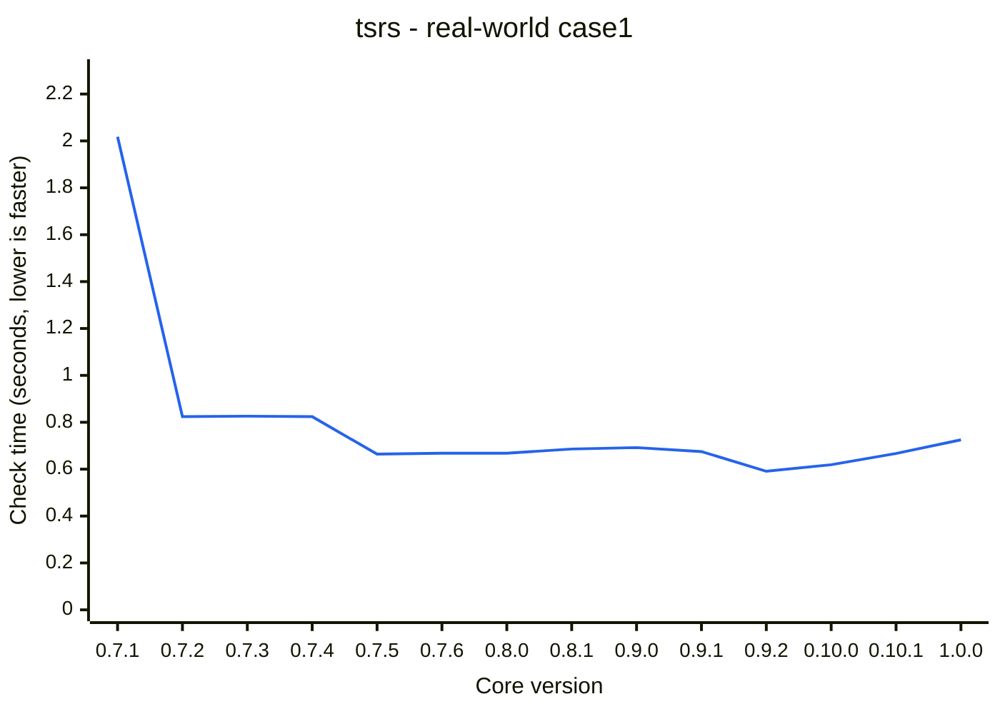

# TypeSQL

Write SQL in TypeScript and get exact types for rows and parameters. TypeSQL parses your SQL inside the type checker: no codegen, no database connection, no build step.

TypeSQL supports PostgreSQL and SQLite. MySQL is planned.

[](https://cdn.jsdelivr.net/gh/ismailkarsli/TypeSQL@main/assets/demo.mp4)

## Get started

### Get your schema

TypeSQL checks queries against a `DB` type that describes your tables. Derive it [from your migrations](https://typesql.karsli.net/guide/migrations), generate it [from a live database](https://typesql.karsli.net/guide/introspect), or take it [from Kysely, Drizzle or Prisma](https://typesql.karsli.net/guide/orms).

You can also [write it by hand](https://typesql.karsli.net/guide/schema) with your database's type names.

### Write typed queries

Create `sql` from your driver's client, import the schema and run SQL against it:

```ts
import { Pool } from "pg";
import { createSql } from "@typesql/pg";
import type { DB } from "./db/schema";

const sql = createSql<DB>(new Pool());

// rows is { email: string; title: string | null }[]: the LEFT JOIN makes title nullable.
// sql.param() sends userId as a parameter, typed like u.id, so it must be a number.
const rows = await sql(
  `SELECT u.email, p.title
   FROM users u LEFT JOIN posts p ON p.author_id = u.id
   WHERE u.id = ${sql.param(userId)}`,
).execute();

// Compile error: column "emial" does not exist. Perhaps you meant the column "email"?
sql("SELECT emial FROM users");
```

`@typesql/postgres` works the same way with postgres.js, and `@typesql/sqlite` with node:sqlite, better-sqlite3 and bun:sqlite; see [SQLite](https://typesql.karsli.net/guide/sqlite).

## Editor support

Every TypeScript editor shows a query's row type on hover and underlines mistakes in the SQL. The TypeSQL extension for VS Code ([Marketplace](https://marketplace.visualstudio.com/items?itemName=typesql.typesql), [Open VSX](https://open-vsx.org/extension/typesql/typesql)) adds table and column completions and syntax highlighting inside `sql()` strings. See [VS Code](https://typesql.karsli.net/guide/vscode) and [Neovim](https://typesql.karsli.net/guide/neovim).

## Try it online

[Open the example in the TypeScript Playground](https://www.typescriptlang.org/play/?moduleResolution=100#code/JYWwDg9gTgLgBAbzgYygUwIYzQZQI4A2ANHDAJ5hpwAKGUGIAzgCoVonmVwBKEA7qy4BfOADMoEEHABEAAU5pGhAPTJoaaQG4AUKEixEpNnADCEYnEiMYAc3SM4I8ZJny2SgqvXKrt+1u1dADtsKFEMZCoAEQAhRG0ASABXRjQoRgAueISE4AATLLMCAB5pYBCAFmkSJAALDEYotHCkghgsmCgkqiEAPh0ctBAMYAJC81LsAA8YaX7EhLzgRjACDDIAfSCGNHGS6WnZmrgg1rWAIwJd0i6e+ZzUTGw8jaw9ydBFGAYwGAAvaqGeqNZoYVrtG7dRz3IQDXyZbK5AqmCZlEIADkBdQaTRabQ6t2hAwSYJgtWgG3y7zRMCq9wSMGAMCu1MOc2J5wgeTIrLQMyxJzOGEu106UL6A1h2iEgTUQWscA8cAAvCh0FhcIRirFegAKXx2RQASh02jlCrwKsVhF1iQABjgAKIAGUdJmYcCSADp8iRvUMRhYwF7Gcy0No4JGo9GYwAxbgAeQAsp7UulPXBXbGPQApBMASQAcpYINYHGA4Ani8HSeSoJS8lbvfkIzG21GAOoACUd3Ednp9jdVABIAIx2oiJADsk5N2gUPH4Vt4AjYxQUEFEcDw8wXtHoTCt+4YLDXG63O9N5vg1iwDlVHltCQdLrdHtrFN9KAgSRCuoAVEaJDDFMuqhlcRpwAAgjgcBrNgCrxsmJZlnAADiiYAKrUHAMQAJpwB+9b5BO2hzguODfDA96LqulDrmwm6KlRjDzGaEDyvAAajFa0gYHkGCyHyPxXF6aggAE15qk8aBDtaBBPnaRZOtwHpFswCapmkDi6txBCQQAalBzqYY6sG6sOCAeF6YB0AwunDKMRpCJBfbMJh3CFkWaFwF+jwai8WCkeRxgmOqzzLvwghoAxlBMf5zxsY+L6uu6JwgFQSEpik2l2nOyXKb2amFhpKHUXAYFMhBcBGSZZkVWORoTjIXZoAQBAQNIc5AA) <span data-playground="core"></span>: edit the SQL and hover the types, with nothing to install. The Playground runs TypeScript 6, so treat it as a demo.

## Tested against the database's own tests

The parser is checked against the regression tests the database runs on itself. For PostgreSQL that is about 50,000 statements, and TypeSQL agrees with Postgres on every one that can be checked statically: it parses what Postgres parses and rejects what Postgres rejects. CI fails on a single disagreement. See [Postgres compatibility](https://typesql.karsli.net/guide/postgres-compatibility). SQLite statements are compared with the SQLite that ships with Node: outcome, error message, column names and the values each column returns.

## Compile time

<span id="performance-summary-start"></span>
The [real-world application workload](packages/bench/src/case1.ts) contains 379 statements and reusable SQL fragments. Average check time per statement, including schema and fragment checking: 6.33 ms with `tsc` and 1.91 ms with [tsrs](https://github.com/oxc-project/tsrs).

| Application workload | `tsc` | tsrs |
|---|---|---|
| `case1` | 2.4 s | 0.725 s |
<span id="performance-summary-end"></span>

See [Performance](https://typesql.karsli.net/guide/performance) for how this is measured.

### Performance by release

tsrs check time for the [real-world application](packages/bench/src/case1.ts) by `@typesql/core` version. Lower is faster. Every refresh remeasures all releases from 0.7.1 in one CI job with the same compilers, using the median of three checks per variant.

<span id="performance-history-start"></span>


<span id="performance-history-end"></span>

[Measurement history](packages/bench/history.json).

## Documentation

The full guide is at **[typesql.karsli.net](https://typesql.karsli.net)**. It covers the SQL TypeSQL supports, parameters and fragments, writing data, performance, and known limits.

## License

[MIT](LICENSE)
