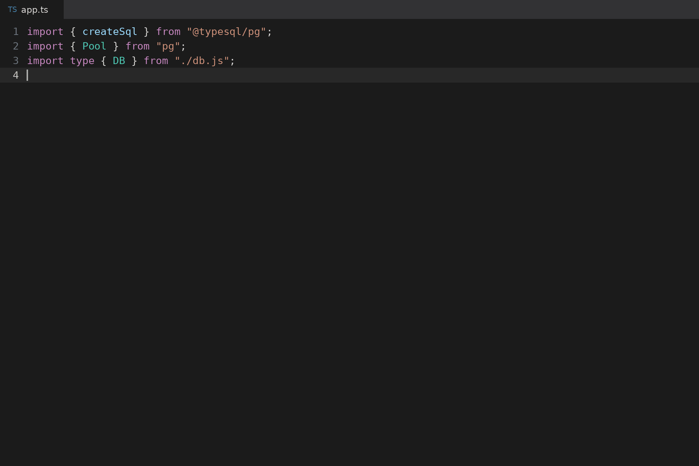

<h1>
  <picture>
    <source media="(prefers-color-scheme: dark)" srcset=".github/assets/logo-dark.svg">
    
  </picture>
</h1>

Write SQL in TypeScript and get exact types for rows and parameters. TypeSQL parses your SQL inside the type checker: no codegen, no database connection, no build step.

TypeSQL supports PostgreSQL and SQLite. MySQL is planned.

<a href="https://www.npmjs.com/package/@typesql/core"></a>
<a href="https://www.npmjs.com/package/@typesql/core"></a>
<a href="https://bundlejs.com/?q=@typesql/core"></a>
<a href="https://github.com/ismailkarsli/TypeSQL"></a>
<a href="LICENSE"></a>

[](https://cdn.jsdelivr.net/gh/ismailkarsli/TypeSQL@main/.github/assets/demo.mp4)

## Get started

### Get your schema

TypeSQL checks queries against a `DB` type that describes your tables. Derive it [from your migrations](https://typesql.karsli.net/guide/migrations), generate it [from a live database](https://typesql.karsli.net/guide/introspect), or take it [from Kysely, Drizzle or Prisma](https://typesql.karsli.net/guide/orms).

You can also [write it by hand](https://typesql.karsli.net/guide/schema) with your database's type names.

### Write typed queries

Create `sql` from your driver's client, import the schema and run SQL against it:

```ts
import { Pool } from "pg";
import { createSql } from "@typesql/pg";
import type { DB } from "./db/schema";

const sql = createSql<DB>(new Pool());

// rows is { email: string; title: string | null }[]: the LEFT JOIN makes title nullable.
// sql.param() sends userId as a parameter, typed like u.id, so it must be a number.
const rows = await sql(
  `SELECT u.email, p.title
   FROM users u LEFT JOIN posts p ON p.author_id = u.id
   WHERE u.id = ${sql.param(userId)}`,
).execute();

// Compile error: column "emial" does not exist. Perhaps you meant the column "email"?
sql("SELECT emial FROM users");
```

`@typesql/postgres` works the same way with postgres.js, and `@typesql/sqlite` with node:sqlite, better-sqlite3 and bun:sqlite; see [SQLite](https://typesql.karsli.net/guide/sqlite).

## Editor support

Every TypeScript editor shows a query's row type on hover and underlines mistakes in the SQL. The TypeSQL extension for VS Code ([Marketplace](https://marketplace.visualstudio.com/items?itemName=typesql.typesql), [Open VSX](https://open-vsx.org/extension/typesql/typesql)) adds table and column completions and syntax highlighting inside `sql()` strings. See [VS Code](https://typesql.karsli.net/guide/vscode) and [Neovim](https://typesql.karsli.net/guide/neovim).

## Try it online

[Open the example in the TypeScript Playground](https://www.typescriptlang.org/play/?moduleResolution=100#code/JYWwDg9gTgLgBAbzgYygUwIYzQZQI4A2ANHDAJ5hpwAKGUGIAzgCoVonmVwBKEA7qy4BfOADMoEEHABEAAU5pGhAPTJoaaQG4AUKEixEpNnADCEYnEiMYAc3SM4I8ZJny2SgqvXKrt+1u1dADtsKFEMZCoAEQAhRG0ASABXRjQoRgAueISE4AATLLMCAB5pYBCAFmkSJAALDEYotHCkghgsmCgkqiEAPh0ctBAMYAJC81LsAA8YaX7EhLzgRjACDDIAfSCGNHGS6WnZmrgg1rWAIwJd0i6e+ZzUTGw8jaw9ydBFGAYwGAAvaqGeqNZoYVrtG7dRz3IQDXyZbK5AqmCZlEIADkBdQaTRabQ6t2hAwSYJgtWgG3y7zRMCq9wSMGAMCu1MOc2J5wgeTIrLQMyxJzOGEu106UL6A1h2iEgTUQWscA8cAAvCh0FhcIRirFegAKXx2RQASh02jlCrwKsVhF1iQABjgAKIAGUdJmYcCSADp8iRvUMRhYwF7Gcy0No4JGo9GYwAxbgAeQAsp7UulPXBXbGPQApBMASQAcpYINYHGA4Ani8HSeSoJS8lbvfkIzG21GAOoACUd3Ednp9jdVABIAIx2oiJADsk5N2gUPH4Vt4AjYxQUEFEcDw8wXtHoTCt+4YLDXG63O9N5vg1iwDlVHltCQdLrdHtrFN9KAgSRCuoAVEaJDDFMuqhlcRpwAAgjgcBrNgCrxsmJZlnAADiiYAKrUHAMQAJpwB+9b5BO2hzguODfDA96LqulDrmwm6KlRjDzGaEDyvAAajFa0gYHkGCyHyPxXF6aggAE15qk8aBDtaBBPnaRZOtwHpFswCapmkDi6txBCQQAalBzqYY6sG6sOCAeF6YB0AwunDKMRpCJBfbMJh3CFkWaFwF+jwai8WCkeRxgmOqzzLvwghoAxlBMf5zxsY+L6uu6JwgFQSEpik2l2nOyXKb2amFhpKHUXAYFMhBcBGSZZkVWORoTjIXZoAQBAQNIc5AA) <span data-playground="core"></span>: edit the SQL and hover the types, with nothing to install. The Playground runs TypeScript 6, so treat it as a demo.

## Documentation

The full guide is at **[typesql.karsli.net](https://typesql.karsli.net)**. It covers the SQL TypeSQL supports, parameters and fragments, writing data, and known limits. Upgrading? See the [upgrade guide](https://typesql.karsli.net/guide/upgrading) and the [changelog](https://typesql.karsli.net/changelog).

## License

[MIT](LICENSE)
